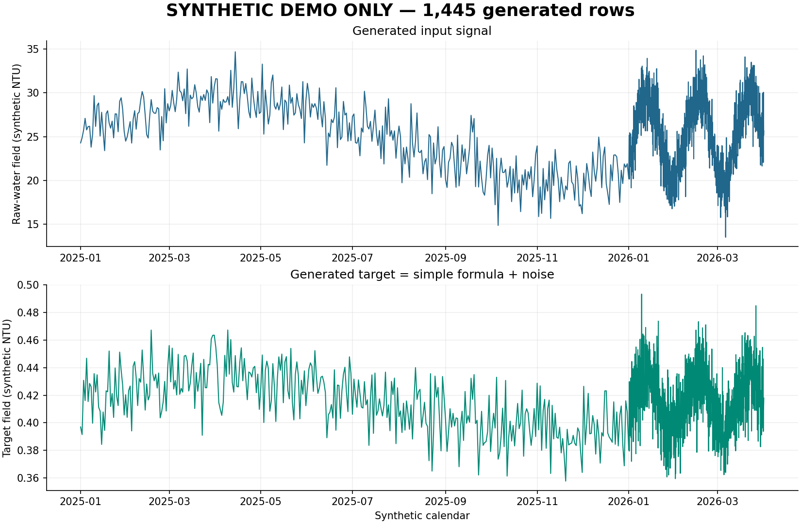
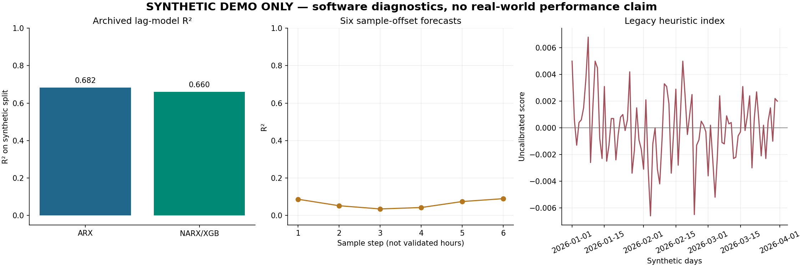

# Water Quality Modeling Study · 水质建模练习

一份本地水质分析与预测练习的源码归档：从清洗、探索图、因素筛选，到回归预测、滞后特征和启发式风险分数。保留19份独立脚本及原目录的版本映射，提供一条使用**完全合成数据**的可运行路线。



**状态：研究练习/WIP；合成数据软件通路已逐步验证，真实数据、工艺与论文结论未复现。** 原目录/脚本沿用了APMCM、Nature等历史命名，不能据此认定参加赛事、获奖、投稿或获期刊认可；本README不把模板中的作者、指标或AI交互故事当作个人履历。

## 快速运行

当前实测：Windows x86-64、Python3.12、CPU。建议在独立虚拟环境安装：

```powershell
python -m venv .venv
./.venv/Scripts/Activate.ps1
pip install -r requirements.txt
python scripts/run_demo.py
python scripts/render_demo_summary.py
```

输入、日志和原始绘图输出均在被Git忽略的`.runtime/`。公开概览图与标注结果由最后一个命令生成到`docs/`。首次运行约需一分钟以上，具体取决于CPU；无需账号、模型API、真实水厂数据或GPU。Linux x86-64可按上游CPU wheel支持情况自行准备环境，本次没有跨平台验收；macOS/其他平台不在当前锁定安装保证范围内。

创建器用固定种子20261026生成1,445条记录：2025年365日频点，2026年前三月1,080个两小时点，目标由简单公式和噪声构造，备注明确标为SYNTHETIC。没有读入原始Excel行。`phase1`清洗和EDA，`phase2`筛选因素并比较线性/XGBoost/SVR，`phase3`计算滞后/六步样例与旧启发式分数。

如阶段已经成功、只是后续中断，可用`python scripts/run_demo.py --resume-from phase2`或`--resume-from phase3`复用同一个合成工作区。工具核对合成标记和此前成功记录，不重建输入或重复已过阶段。本次phase1复用先前31.25秒成功记录，phase2续跑13.64秒，修复绘图后的phase3续跑24.47秒；不是一次从空环境完整安装、连续运行的声明。

CPU依赖固定`xgboost-cpu==3.4.1`。本机普通下载两次超时后，使用[官方PyPI文件](https://pypi.org/project/xgboost-cpu/3.4.1/#files)的分段下载并核对SHA，再离线装入专用环境，实际导入3.4.1且USE_CUDA=False；未安装CUDA或更改全局Python配置。其他库来自既有环境与专用小venv，未宣称全新纯净环境安装整份requirements已经通过。

## 结果能说明什么



图中ARX/NARX合成划分R²约0.682/0.660，六步样例约0.035–0.090；如实保留低分，没有为了展示重写模型或调高分数。它们只证明代码在这个人为数据分布上产出结果，不能替代真实年度外推、工况校验或水安全评估。

原模型仍有需要研究的问题：不同年份采样间隔不同，部分处理只保留DATE；滞后按记录步长操作，旧图中的小时标签未校准；部分筛选/标准化/随机划分的验证设计需复核。启发式分数还会出现负值，阈值与权重没有工艺或现行标准适用性证明。公开诊断图因此只写sample step与uncalibrated index，不将这些结果解释成真实安全结论。

## 源码与数据范围

| 内容 | 保存情况 |
|---|---|
| src/ | 原18 Python+1 JS独立源码；增加显式工作区辅助模块 |
| docs/source-map.json | 32个原源码路径映射到19文件；另一个目录中的13份均与对应版本字节相同 |
| scripts/ | 新合成输入、可续跑通路与从实际结果绘图的入口 |
| patches/ | 一行三月图颜色修复，未更改模型、阈值或结果 |
| docs/synthetic-demo-results.json | 仅本次合成数值摘要，无真实观测记录 |
| 原Excel/赛题PDF/历史论文与图表 | 未上传；清单记录16个独立表格文件，缺少再分发依据，原件继续留本地 |

发布副本泛化了私人Desktop路径；工作区必须有`.apmcm-workspace`标记，默认`.runtime`与原目录分开。原始源文件不改动。硬编码的未核实参赛编号与模板作者栏换成示例占位；全部源码/变体关系保留，没有把缺少授权的数据当作代码遗漏。

## 历史文稿与未验分支

11个绘图/论文/声明/提交/整理模板默认关闭输出，代码仍保存供复查。它们含旧固定指标、未核实叙述或AI交互示例，不是实际发生的记录。本次没有生成论文、AI使用声明、参赛材料或Word/PDF成品。文件名保留只用于历史追踪。

原Excel导入、最终改进/一致性分支、历史配图和Word生成器仅做源码/语法保全，前置见[SCRIPT_STATUS.md](SCRIPT_STATUS.md)。Word导出另依赖docx2pdf与本机Word等软件；可选Node docx9.7.1完整新树未安装验证。详细证据见[VALIDATION.md](VALIDATION.md)，后续计划见[CHANGELOG.md](CHANGELOG.md)。

自有代码/整理采用[MIT](LICENSE)，依赖各自许可见[NOTICE.md](NOTICE.md)。数据、赛题、历史文稿的权利与完整性缺口未解决，不能据此次源码与合成验证删除本地原工程。
